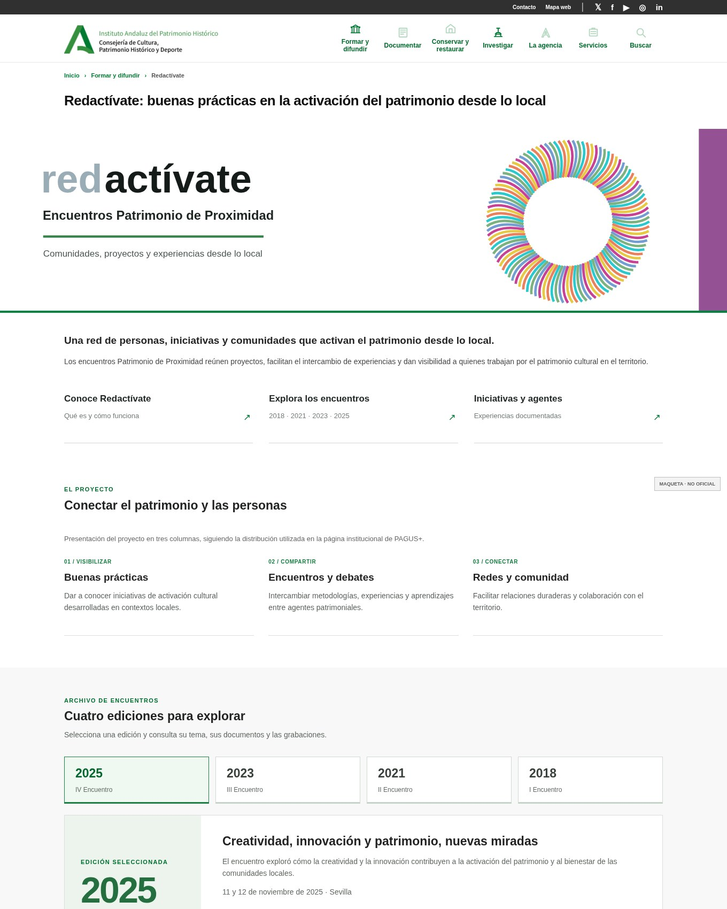

# IAPH-Redactivate-Demo

Propuesta visual de actualización de Redactívate · Patrimonio de Proximidad.

**Estado:** prototipo HTML/CSS/JS para presentación, no página oficial ni módulo Drupal instalable.

## Vista previa



Las imágenes panorámicas y las tarjetas **se muestran al instante** mediante recursos locales. Si el navegador consigue cargar los originales publicados por la Junta, se muestran automáticamente sobre las ilustraciones. No hay enlaces «Ver imagen oficial». Las imágenes SVG locales son ilustraciones de maqueta, no fotografías oficiales.

## Vista en GitHub Pages

1. Crear un repositorio público en GitHub con el nombre que prefieras (por ejemplo, `IAPH-Redactivate-Demo`).
2. Descomprimir el ZIP y subir **el contenido de esta carpeta**, no el ZIP como archivo. `index.html` debe quedar en la **raíz** del repositorio.
3. Abrir **Settings → Pages → Build and deployment**. En **Source**, elegir **Deploy from a branch**. Seleccionar `main` y `/(root)` y guardar.
4. El sitio normalmente tendrá dirección `https://TU-USUARIO.github.io/NOMBRE-DEL-REPOSITORIO/`. Comprueba la URL definitiva en Settings → Pages.

No requiere Node.js, dependencias, base de datos, build ni servidor. El diseño está preparado para abrirse como web estática.

## Funcionalidad

Selector interactivo de cuatro ediciones, acceso a documentos originales, filtro local de tres iniciativas y menú responsive.

**Nota:** los datos de la maqueta son una **selección fija de referencia fechada en noviembre de 2026**, no un catálogo actualizado automáticamente. No se deben presentar como una agenda en tiempo real.

## Estructura

```text
index.html            # Página inicial para GitHub Pages
css/portal.css        # Estilos generales
css/institucional.css # Ajustes de apariencia corporativa
js/portal.js          # Interacciones locales de la maqueta
assets/               # Cabecera e ilustraciones locales para que todo se vea
docs/                 # Informe justificativo PDF
AVISO_MEDIOS_Y_MARCA.md
```

## Traslado al Drupal institucional

No subir el HTML como una página Drupal completa. Conservar la cabecera/pie del tema corporativo y construir solo las secciones centrales mediante los componentes autorizados. Las columnas y los banners están **observados en otras páginas de la Junta**, pero su reutilización en este tipo concreto de contenido queda supeditada al equipo responsable. Las búsquedas necesitan configuración técnica e integración con el catálogo correspondiente.

Fuentes, capturas y matriz de viabilidad: consulta los informes [PDF](docs/Informe_Justificativo_Redactivate_IAPH_2026.pdf) y [Word editable](docs/Informe_Justificativo_Redactivate_IAPH_2026.docx).
